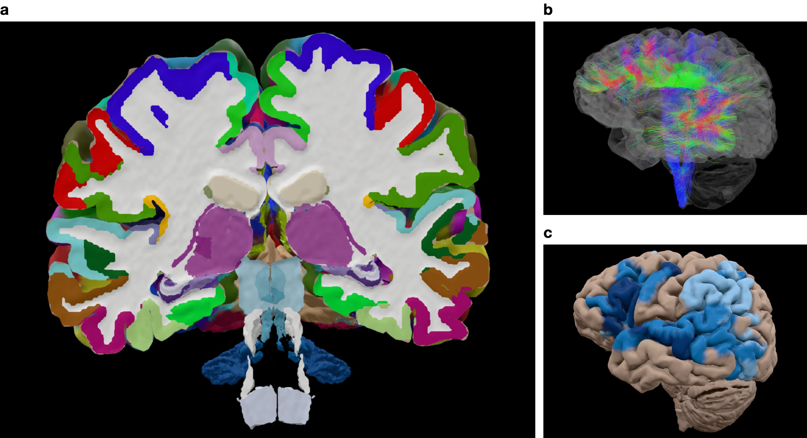
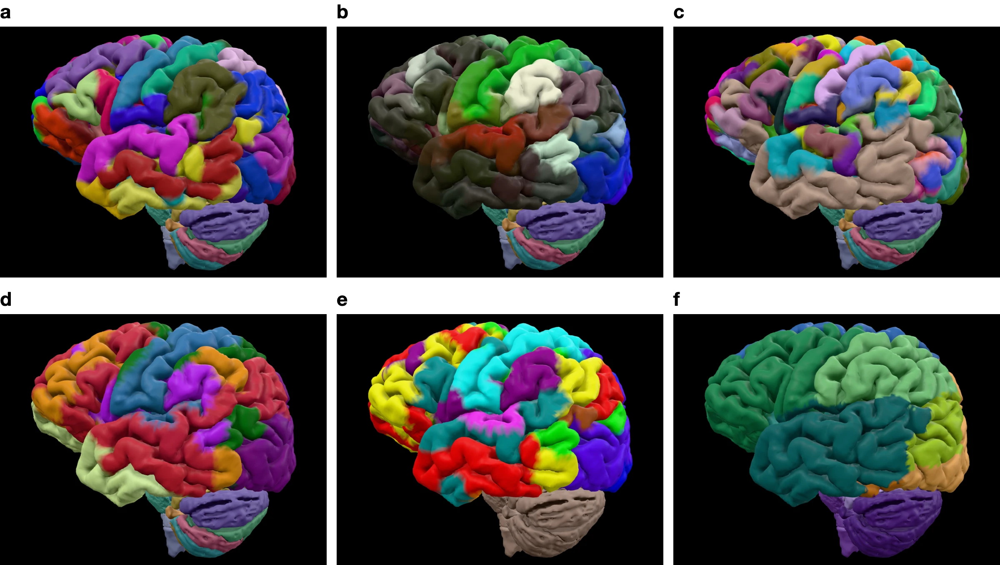
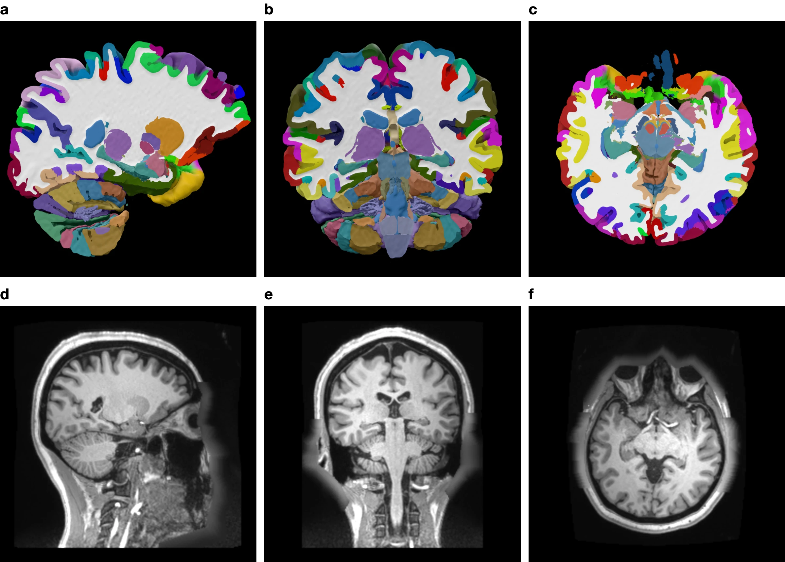
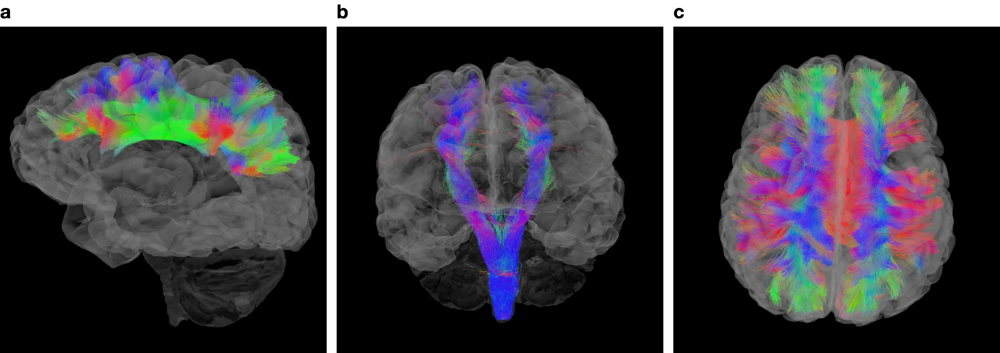
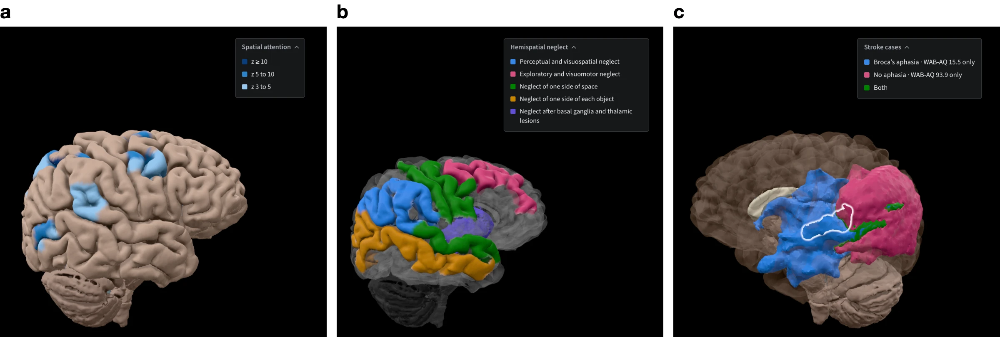
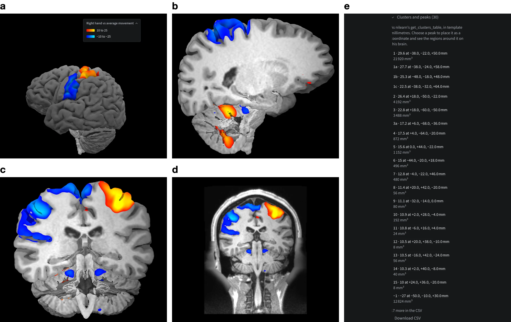
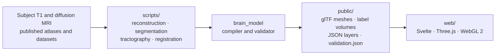

<p align="center">
  <a href="https://planumatlas.com/">
    <picture>
      <source media="(prefers-color-scheme: dark)" srcset=".github/assets/planum-dark.svg">
      
    </picture>
  </a>
</p>

<p align="center"><strong>An interactive atlas of one human brain, traceable to its sources.</strong><br>
Cut, measure and compare one person’s MRI-reconstructed brain in the browser, with its own white-matter pathways and published evidence registered onto it.</p>

<p align="center">
  <a href="https://planumatlas.com/"><strong>Open Planum</strong></a> ·
  <a href="https://planumatlas.com/docs/">Methods</a> ·
  <a href="#getting-started">Getting started</a> ·
  <a href="#citation">Citation</a>
</p>

<p align="center">
  <a href="https://github.com/JoshuaDuq/planumatlas/actions/workflows/deploy.yml"></a>
  <a href="https://planumatlas.com/docs/"></a>
  <a href="LICENSE"></a>
  
  
</p>

<picture>
  <source media="(prefers-color-scheme: dark)" srcset=".github/assets/readme/overview-dark.webp">
  
</picture>

<sub><b>Fig. 1 | One brain, with every layer registered onto it.</b> <b>a</b>, <a href="https://planumatlas.com/#anatomy=cdmd&lang=en&atlas=destrieux&cuts=nextbrain&detail=nextbrain&view=anterior&explode=1">Exploded view</a>, seen from the front: the hemispheres in Destrieux colours, and NextBrain’s deep structures spread by system between them, each moved whole and never reshaped. NextBrain gives the cerebellar nuclei a surface but not the cerebellar cortex. <b>b</b>, <a href="https://planumatlas.com/#anatomy=cdmd&lang=en&atlas=destrieux&cuts=destrieux&detail=learning&tab=diffusion&view=left&opacity=0.16&tracts=af-left,cst-left">Left arcuate fasciculus and corticospinal tract</a> from the subject’s own diffusion MRI, coloured by local direction. <b>c</b>, <a href="https://planumatlas.com/#anatomy=cdmd&lang=en&atlas=hcp-mmp&cuts=hcp-mmp&detail=learning&view=left&tab=functions&function=language">Neurosynth map for language</a> on HCP-MMP areas; darker blue is more consistent (z 3–5, 5–10, ≥ 10).</sub>

## Overview

Planum shows one real brain rather than an average or an illustration: MGH CDMD subject `sub_013`, reconstructed with FreeSurfer 8.2 from its own T1-weighted scan, with 30 tract bundles from the same person’s diffusion MRI. Cortical atlases, subcortical segmentations and group-level functional, vascular and clinical layers are registered onto this anatomy. Every region, cut face and number in the viewer can be traced to its source, and each feature has a [methods page](https://planumatlas.com/docs/) giving its data, method, validation and limitations.

It runs in any WebGL 2 browser, in English and French, with keyboard and touch controls. Nothing is installed, and files you open stay on your computer.

> [!IMPORTANT]
> Planum is for research and education. It is not a medical device and must not inform diagnosis, treatment or any other clinical decision.

| Layer | Contents |
| :--- | :--- |
| **Subject** | MGH CDMD `sub_013` (CC0), FreeSurfer 8.2 reconstruction |
| **Cortex** | Destrieux (148 parcels) · HCP-MMP (360 areas) · Julich-Brain 3.1 (278 areas) · Schaefer (400 parcels) |
| **Internal anatomy** | NextBrain (514 labels, 0.4 mm) · FreeSurfer aseg (32 structures) · teaching set (106 structures) |
| **Cerebellum and cord** | CerebNet lobules (25) · Nettekoven functional regions (32) · PAM50 cervical cord, C1–C5 (34 regions) |
| **White matter** | 30 bundles from the subject’s diffusion MRI: 17 by DIPY RecoBundles, 13 by TractSeg |
| **Evidence** | 70 Neurosynth maps · 131 deficit profiles · 228 stroke lesions · SEEG responses from 27 and 613 people |
| **Your data** | MNI coordinates · NIfTI-1 maps and 4D series, read in the browser |

## Anatomy

<picture>
  <source media="(prefers-color-scheme: dark)" srcset=".github/assets/readme/cortex-dark.webp">
  
</picture>

<sub><b>Fig. 2 | Six colourings of the same left hemisphere.</b> <b>a</b>, <a href="https://planumatlas.com/#anatomy=cdmd&lang=en&atlas=destrieux&cuts=destrieux&detail=learning&view=left">Destrieux</a>, 148 gyral and sulcal parcels. <b>b</b>, <a href="https://planumatlas.com/#anatomy=cdmd&lang=en&atlas=hcp-mmp&cuts=hcp-mmp&detail=learning&view=left">HCP-MMP</a>, 360 multimodal areas. <b>c</b>, <a href="https://planumatlas.com/#anatomy=cdmd&lang=en&atlas=julich&cuts=julich&detail=learning&view=left">Julich-Brain 3.1</a>, 278 cytoarchitectonic areas. <b>d</b>, <a href="https://planumatlas.com/#anatomy=cdmd&lang=en&atlas=schaefer&cuts=schaefer&detail=learning&view=left">Schaefer</a>, 400 parcels in seven-network colours. <b>e</b>, <a href="https://planumatlas.com/#anatomy=cdmd&lang=en&atlas=destrieux&cuts=destrieux&detail=learning&view=left&colors=cab-np">CAB-NP</a>, 12 networks. <b>f</b>, <a href="https://planumatlas.com/#anatomy=cdmd&lang=en&atlas=destrieux&cuts=destrieux&detail=learning&view=left&colors=territory">Arterial territories</a> (Liu et al., 2023). Same camera and scale in every panel.</sub>

Four cortical atlases share one surface, and the cortex can also be coloured by lobe, Yeo or CAB-NP networks, arterial territory or the subject’s T1, and drawn on the pial, mid-thickness or white surface to open the sulci. Beneath it, choose NextBrain’s 514 labels at 0.4 mm (292 meshed structures and 222 more on cut faces), FreeSurfer’s 32 aseg structures or a 106-structure teaching set, down through the brainstem, the cerebellar lobules and the cervical cord. A selected region reports its volume or surface area, centroid and source labels; **Focus**, **Isolate** and **Hide** dissect it in context, and the **Exploded view** pulls the structures apart by system, each whole.

Methods: [cortical atlases](https://planumatlas.com/docs/features/cortical-atlases.html) · [internal anatomy](https://planumatlas.com/docs/features/internal-anatomy.html) · [spinal cord](https://planumatlas.com/docs/features/spinal-cord.html) · [dissection and display](https://planumatlas.com/docs/features/dissection-and-display.html)

## Sections and linked MRI

<picture>
  <source media="(prefers-color-scheme: dark)" srcset=".github/assets/readme/sections-dark.webp">
  
</picture>

<sub><b>Fig. 3 | Capped sections and the subject’s own scan.</b> <b>a–c</b>, <a href="https://planumatlas.com/#anatomy=cdmd&lang=en&atlas=destrieux&cuts=destrieux&detail=learning&cut=sagittal&pos=-20&view=right">Sagittal</a> (x = −20 mm, from the right), <a href="https://planumatlas.com/#anatomy=cdmd&lang=en&atlas=destrieux&cuts=destrieux&detail=learning&cut=coronal&pos=-20&view=anterior">coronal</a> (y = −20 mm, from the front) and <a href="https://planumatlas.com/#anatomy=cdmd&lang=en&atlas=destrieux&cuts=destrieux&detail=learning&cut=axial&pos=12&view=superior">axial</a> (z = 12 mm, from above) cuts; each structure is capped where the plane meets it, coloured from the Destrieux cut labels. <b>d–f</b>, The T1-weighted scan in the same planes, as <b>Linked MRI</b> shows it. Positions are FreeSurfer surface RAS.</sub>

Cut sagittally, coronally, axially or at any oblique angle. Cap colours come from the chosen label volume, not from the meshes, so the same cut can show Destrieux, HCP-MMP, Julich-Brain, Schaefer, NextBrain, arterial, cerebellar or striatal labels. **Linked MRI** opens the scan in three planes around a shared crosshair, with window and level, a segmentation overlay, the label at the crosshair and PNG export. It also opens from a function’s or deficit’s profile and draws that paint on the scan.

Methods: [sections and cuts](https://planumatlas.com/docs/features/sections-and-cuts.html) · [linked MRI](https://planumatlas.com/docs/features/linked-mri.html) · [boundary certainty](https://planumatlas.com/docs/features/boundary-certainty.html) · [segmentation agreement](https://planumatlas.com/docs/features/segmentation-agreement.html)

## White matter

<picture>
  <source media="(prefers-color-scheme: dark)" srcset=".github/assets/readme/tracts-dark.webp">
  
</picture>

<sub><b>Fig. 4 | Association, projection and commissural pathways of the same person.</b> <b>a</b>, <a href="https://planumatlas.com/#anatomy=cdmd&lang=en&atlas=destrieux&cuts=destrieux&detail=learning&tab=diffusion&view=left&opacity=0.16&tracts=slf1-left,slf2-left,slf3-left">Left superior longitudinal fasciculus I–III</a>, from the left. <b>b</b>, <a href="https://planumatlas.com/#anatomy=cdmd&lang=en&atlas=destrieux&cuts=destrieux&detail=learning&tab=diffusion&view=anterior&opacity=0.16&tracts=cst-left,cst-right">Left and right corticospinal tracts</a>, from the front. <b>c</b>, <a href="https://planumatlas.com/#anatomy=cdmd&lang=en&atlas=destrieux&cuts=destrieux&detail=learning&tab=diffusion&view=superior&opacity=0.16&tracts=callosum-1,callosum-2,callosum-3,callosum-4,callosum-5,callosum-6,callosum-7">Seven corpus callosum segments</a>, from above. Streamlines are coloured by local direction (red left–right, green anterior–posterior, blue superior–inferior) inside a cortex at 16 % opacity.</sub>

Load any of 30 bundles reconstructed from this subject’s diffusion scan, in both hemispheres where paired: the arcuate, uncinate, inferior fronto-occipital, inferior and middle longitudinal fasciculi, cingulum and corticospinal tract; the superior longitudinal fasciculus whole and as SLF I–III; and the corpus callosum whole and as seven segments. Filter streamlines by length, export their lengths as CSV, or inspect them on linked T1 and FA images. Streamline counts are not axon counts, and lengths do not measure connection strength.

Methods: [tracts](https://planumatlas.com/docs/features/tracts.html)

## Functional and clinical evidence

<picture>
  <source media="(prefers-color-scheme: dark)" srcset=".github/assets/readme/evidence-dark.webp">
  
</picture>

<sub><b>Fig. 5 | Group evidence on one anatomy.</b> <b>a</b>, <a href="https://planumatlas.com/#anatomy=cdmd&lang=en&atlas=hcp-mmp&cuts=hcp-mmp&detail=learning&tab=functions&function=spatial-attention&view=right">Where studies of healthy groups report activation for spatial attention</a> (Neurosynth, HCP-MMP areas with z ≥ 3). <b>b</b>, <a href="https://planumatlas.com/#anatomy=cdmd&lang=en&atlas=destrieux&cuts=destrieux&detail=learning&tab=deficits&deficit=neglect&view=right">Regions cited for hemispatial neglect</a>, one colour per published finding. <b>c</b>, <a href="https://planumatlas.com/#anatomy=cdmd&lang=en&atlas=destrieux&cuts=destrieux&detail=learning&region=destrieux:left:4&cases=M2295,M2272">Two Aphasia Recovery Cohort lesions</a> and their overlap, with the left subcentral region outlined.</sub>

These layers place published evidence beside the anatomy with its sources and limits in view. A paint can also be drawn over the subject’s T1, which shows wherever nothing is painted. The layers describe group findings, templates and spatial overlap; they are not measurements of this individual or predictions for a patient.

| Layer | What it shows |
| :--- | :--- |
| [Functions](https://planumatlas.com/docs/features/functions.html) | 70 curated Neurosynth consistency maps with ranked regional scores; 277 further terms by search. |
| [Deficits](https://planumatlas.com/docs/features/deficits.html) | 131 acquired adult deficit profiles citing 339 references, each finding with its regions, population and limits. |
| [Circuits](https://planumatlas.com/docs/features/circuits.html) | Five guided pathways with 25 landmarks and notes on the relays they omit. |
| [Stroke cases](https://planumatlas.com/docs/features/stroke-cases.html) | 228 Aphasia Recovery Cohort lesions, with lesion volume and WAB aphasia quotient. |
| [Stimulation responses](https://planumatlas.com/docs/features/stimulation-responses.html) | SEEG response rates with their sample counts, from Lyu et al. (27 people) and F-TRACT v2307 (613 people). |
| [Visual field map](https://planumatlas.com/docs/features/visual-field-map.html) | The V1–V3 response to a dot in the visual field, predicted from this brain’s folding by the Benson template and a pRF model, on both hemispheres side by side; no retinotopy was measured. |
| [Functional networks](https://planumatlas.com/docs/features/functional-networks.html) | Yeo 7 and CAB-NP 12 networks, with [cerebellar](https://planumatlas.com/docs/features/cerebellar-functions.html) and [striatal](https://planumatlas.com/docs/features/striatal-networks.html) counterparts and [functional divisions](https://planumatlas.com/docs/features/functional-divisions.html). |

A selected region also opens its [atlas comparison](https://planumatlas.com/docs/features/atlas-comparison.html), [receptor fingerprint](https://planumatlas.com/docs/features/receptor-fingerprints.html) (up to 17 receptors), [arterial territory](https://planumatlas.com/docs/features/arterial-territories.html) and [boundary certainty](https://planumatlas.com/docs/features/boundary-certainty.html).

## Bring your own data

<picture>
  <source media="(prefers-color-scheme: dark)" srcset=".github/assets/readme/overlay-dark.webp">
  
</picture>

<sub><b>Fig. 6 | A published group map, opened in the Overlay tool.</b> HCP motor task, right hand minus the average of all movements: the group z map of 486 people (<a href="https://neurovault.org/images/3161/">NeuroVault image 3161</a>), in FSL’s MNI152, opened as an MNI map of unstated template and drawn at |z| > 10, colours to 25. <b>a</b>, Left hemisphere, with the key titled in the tool: the hand area of the left motor cortex in red, the precentral cortex below it, where the other movements dominate, in blue. <b>b</b>, Sagittal cut at x = 18 mm, seen from the right: two right cerebellar clusters, the hand representations ipsilateral to the moving hand. <b>c</b>, Coronal cut at y = −22 mm, seen from the front: red in the left motor cortex, blue in the right. <b>d</b>, The same plane on the subject’s T1 in <b>Linked MRI</b>. <b>e</b>, The cluster table, computed as nilearn’s <code>get_clusters_table</code> computes it, in template millimetres. Data: Human Connectome Project, WU-Minn Consortium.</sub>

- **[Published coordinates](https://planumatlas.com/docs/features/published-coordinates.html).** Place a coordinate from MNI152NLin2009cAsym or SPM12 space on this brain and read the regions around it.
- **[Overlays](https://planumatlas.com/docs/features/overlays.html).** Open an MNI-space NIfTI-1 map or 4D series and draw it on the surfaces, cut faces and MRI, with thresholds, clusters and a region time course. The file is read in the browser and never uploaded.
- **[Lesion report](https://planumatlas.com/docs/features/lesion-report.html).** Place a sphere of 3–30 mm radius and measure the tissue, functions, deficits and tracts it reaches.
- **[Links and images](https://planumatlas.com/docs/features/sharing-and-snapshots.html).** A link restores the selection, camera, section, display and placed lesion. **Save image** exports the stage with its orientation, scale and colour key.

## How it is built



Preparation scripts reconstruct, segment, track and register the subject once. The `brain_model` compiler turns the results into meshes, gzipped label volumes and JSON layers, and records its measurements in `validation.json`; its validator checks the published anatomy against the source volumes, surfaces and labels. Deployment is gated on the Python tests, the anatomy validation and the web tests, each rerun when its inputs change. In the viewer, the **Provenance** panel names the subject, reconstruction, atlases and source files behind what is shown.

| Path | Contents |
| :--- | :--- |
| [`brain_model/`](brain_model) | Offline Python compiler and validator |
| [`config/`](config), [`data/`](data) | Build configuration, the committed reconstruction and curated evidence layers |
| [`scripts/`](scripts) | Reconstruction, segmentation, tractography, registration and data retrieval |
| [`public/`](public) | Published models and diffusion data served to the viewer |
| [`web/`](web) | The viewer and its rendering engine |
| [`docs/`](docs) | Sphinx methods pages |
| [`tests/`](tests) | Python tests |

## Getting started

Open **[planumatlas.com](https://planumatlas.com/)**. To run the viewer locally you need Node.js (CI uses version 24) and a WebGL 2 browser. The published assets are in the repository, about 470 MB, so no Python build is needed to explore them.

```bash
git clone --depth 1 https://github.com/JoshuaDuq/planumatlas.git
cd planumatlas/web
npm ci
npm run dev
```

Vite prints the local address, normally `http://127.0.0.1:5173/`.

<details>
<summary><strong>Rebuild, validate and test</strong></summary>

The pipeline uses [uv](https://docs.astral.sh/uv/) and Python 3.12 or 3.13.

```bash
uv sync --locked
uv run python -m brain_model.build --anatomy cdmd
uv run python -m brain_model.validate --anatomy cdmd
uv run pytest
npm test --prefix web
```

Build the methods documentation with warnings treated as errors:

```bash
uv sync --locked --group docs
uv run sphinx-build -W -b html docs docs/_build/html
```

Each methods page lists the commands that rebuild and test its feature under **Code availability**.

</details>

<details>
<summary><strong>Use the rendering engine</strong></summary>

`createEngine`, exported from [`web/src/lib/engine/index.ts`](web/src/lib/engine/index.ts), loads an anatomy into a Three.js scene without the viewer’s interface. Its contract, the `Engine`, `EngineModel` and `EngineSections` types, is in [`web/src/lib/engine/api.ts`](web/src/lib/engine/api.ts).

</details>

<details>
<summary><strong>Refresh the README figures</strong></summary>

```bash
node scripts/readme-figures.mjs
```

The [figure script](scripts/readme-figures.mjs) captures each panel from [planumatlas.com](https://planumatlas.com/) with Playwright’s Chromium (installed for `web/`), hides the stage controls, crops each capture to its content without recolouring it, and writes light and dark versions to [`.github/assets/readme/`](.github/assets/readme). For Fig. 6 it downloads the HCP map from NeuroVault and opens it in the Overlay tool, as a reader would. Pass another origin, such as a local server, as the first argument, or name figures to render only those.

</details>

## Citation

If you use Planum, cite it and the data behind the views you use; the [references](https://planumatlas.com/docs/reference/references.html) list each source and the acknowledgement it requires. GitHub’s **Cite this repository** menu reads [`CITATION.cff`](CITATION.cff).

```bibtex
@software{planum,
  author  = {Duquette, Joshua},
  title   = {Planum},
  year    = {2026},
  url     = {https://planumatlas.com},
  license = {AGPL-3.0-or-later}
}
```

## Licence and data terms

The code is licensed under the [GNU AGPL 3.0 or later](LICENSE): anyone who runs a modified version for others, including as a website, must offer them its source. [NOTICE](NOTICE) sets out its scope. Neuroimaging data and derived assets under `data/`, `public/models/` and `public/diffusion/` keep the terms of their origin, with full texts in [`public/models/licenses/`](public/models/licenses):

| Terms | Data |
| :--- | :--- |
| CC0 1.0 | MGH CDMD subject data |
| FreeSurfer Software License | FreeSurfer reconstruction and atlases |
| HCP Open Access Data Use Terms | HCP-MMP |
| CAB-NP License (non-commercial) | CAB-NP networks |
| CC BY-NC-SA 4.0 | Julich-Brain, receptor fingerprints, F-TRACT |
| CC BY-NC 3.0 | Nettekoven cerebellar atlas, SUIT |
| CC BY-SA 4.0 | Arterial territories |
| CC BY 4.0 | Lyu et al. stimulation responses, TractSeg weights |
| ODbL 1.0 | Neurosynth |
| AGPL-3.0 | Benson visual-field template (neuropythy) |
| MNI template licence | MNI152NLin2009cAsym |
| GPL-2.0-or-later | SPM12 tissue probability maps (built from IXI, CC BY-SA 3.0) |
| MIT | Schaefer parcellation, PAM50 |
| BSD-2-Clause | Aphasia Recovery Cohort normalised lesions |

Some terms are non-commercial or require attribution. Consult the [references, licences and acknowledgements](https://planumatlas.com/docs/reference/references.html) before reusing any data.

The map in Fig. 6 is not distributed with Planum; [the figure script](scripts/readme-figures.mjs) downloads it from NeuroVault. Data were provided by the Human Connectome Project, WU-Minn Consortium (Principal Investigators: David Van Essen and Kamil Ugurbil; 1U54MH091657) funded by the 16 NIH Institutes and Centers that support the NIH Blueprint for Neuroscience Research; and by the McDonnell Center for Systems Neuroscience at Washington University.
