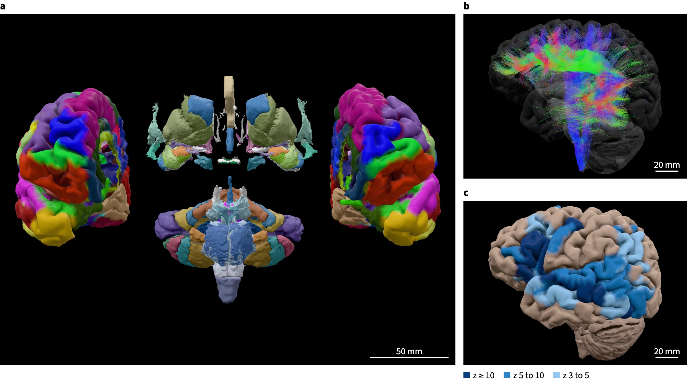
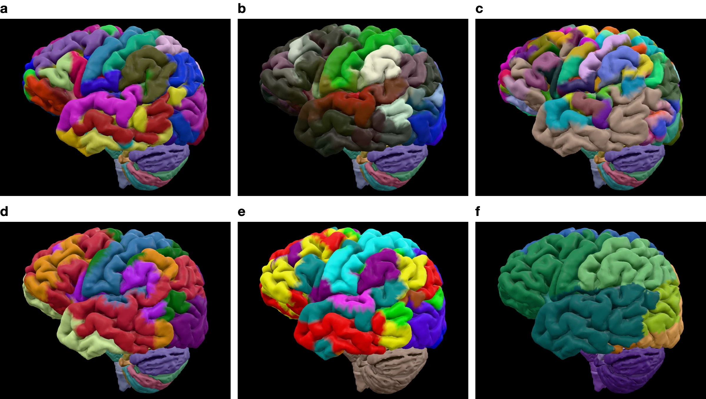
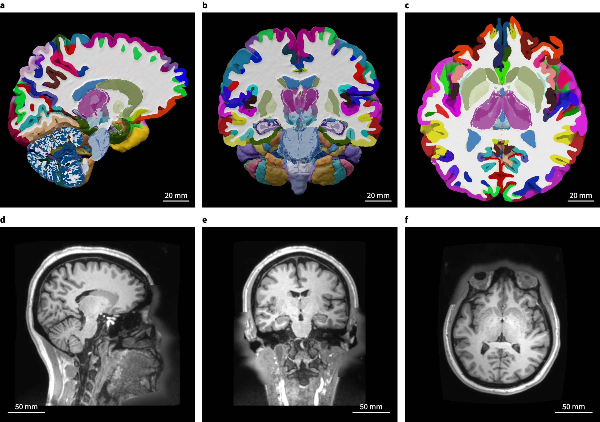
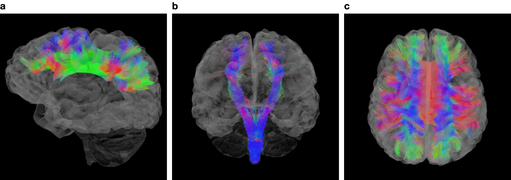
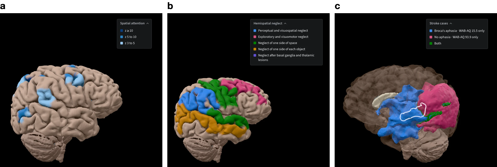
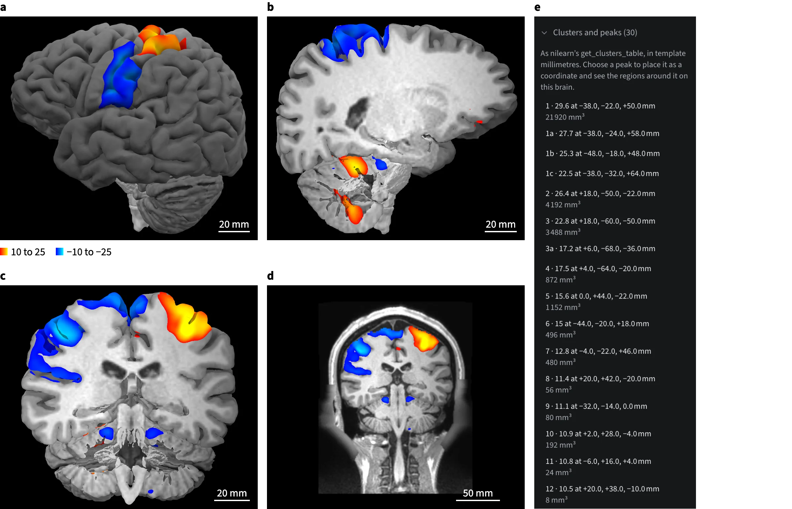
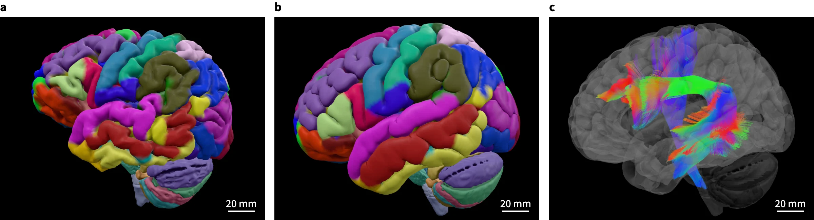
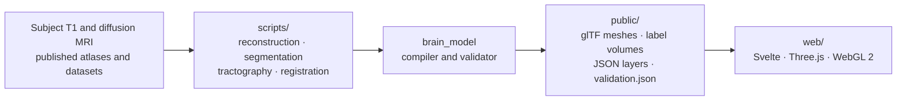

<p align="center">
  <a href="https://planumatlas.com/">
    <picture>
      <source media="(prefers-color-scheme: dark)" srcset=".github/assets/planum-dark.svg">
      
    </picture>
  </a>
</p>

<p align="center"><strong>An open 3D atlas of the human brain, where cortical and deep parcellations, tractography and the published findings for each region are read on the same anatomy.</strong></p>

<p align="center">
  <a href="https://planumatlas.com/"><strong>Open Planum</strong></a> ·
  <a href="https://planumatlas.com/docs/">Methods</a> ·
  <a href="#getting-started">Getting started</a> ·
  <a href="#citation">Citation</a>
</p>

<p align="center">
  <a href="https://github.com/JoshuaDuq/planumatlas/actions/workflows/deploy.yml"></a>
  <a href="LICENSE"></a>
  <a href="https://doi.org/10.5281/zenodo.24428325"></a>
</p>

<picture>
  <source media="(prefers-color-scheme: dark)" srcset=".github/assets/readme/overview-dark.webp">
  
</picture>

<sub><b>Fig. 1 | Every layer is registered onto one brain.</b> <b>a</b>, <a href="https://planumatlas.com/#anatomy=cdmd&lang=en&atlas=destrieux&detail=nextbrain&view=anterior&explode=1">Exploded view</a>, seen from the front. The hemispheres carry Destrieux colours. NextBrain’s deep structures part between them, most of each side as one piece. Every structure is moved whole, never reshaped or taken apart. The cerebellar lobules, corpus callosum and ventricles are the teaching set’s, drawn on this level. <b>b</b>, <a href="https://planumatlas.com/#anatomy=cdmd&lang=en&atlas=destrieux&detail=learning&tab=diffusion&view=left&opacity=0.16&tracts=af-left,cst-left">Left arcuate fasciculus and corticospinal tract</a> from the subject’s own diffusion MRI, seen from the left inside a cortex at 16% opacity and coloured by local direction (red left–right, green anterior–posterior, blue superior–inferior). <b>c</b>, <a href="https://planumatlas.com/#anatomy=cdmd&lang=en&atlas=hcp-mmp&detail=learning&view=left&tab=functions&function=language">Neurosynth map for language</a> on HCP-MMP areas, seen from the left. Areas with a mean z of at least 3 are painted in the three bands of the key. Scale bars apply at the depth of the camera’s target.</sub>

## Overview

Planum is an atlas of the human brain that runs in the browser. It is built from real MRI data, with the surface, the sections and the white-matter tracts all taken from the same brain, so they agree with one another. Widely used cortical parcellations, such as Destrieux, HCP-MMP and Julich-Brain, and a histological atlas of the deep structures are drawn on that anatomy, which makes it possible to see how differently they divide the same tissue. Selecting a region brings up what has been reported about it in meta-analyses of the imaging literature, lesion studies, intracranial stimulation and large group comparisons, each with its source.

Guided tours follow the main pathways step by step, and every view is a link that can go into a lecture, a draft or a message to a colleague. A coordinate or a statistical map from a study can be placed on the brain to see where it falls, and a standard MNI template can be used as the anatomy instead. Planum is free, needs no account, and is meant for learning and research, not for clinical use.

It runs in any WebGL 2 browser, in English and French, with keyboard and touch controls. Nothing is installed, and files you open stay on your computer.

> [!IMPORTANT]
> Planum is for research and education. It is not a medical device and must not inform diagnosis, treatment or any other clinical decision.

The table lists what is drawn, and Fig. 1 shows three of its layers on the brain.

| Layer | Contents |
| :--- | :--- |
| **Subject** | MGH CDMD `sub_013` (CC0), reconstructed with FreeSurfer |
| **Template** | MNI152NLin2009cAsym (ICBM 152 2009c) as a second brain, with bundles of the HCP1065 averaged tract atlas |
| **Cortex** | Destrieux (148 parcels) · Desikan-Killiany (68 regions) · HCP-MMP (360 areas) · Julich-Brain (278 areas) · Schaefer (400 parcels) |
| **Morphometry** | The subject’s own cortical thickness and sulcal depth, per vertex, from its FreeSurfer reconstruction |
| **Internal anatomy** | NextBrain (histological atlas, 0.4 mm) · FreeSurfer aseg · a teaching set · Harvard brainstem arousal nuclei (10 nuclei) |
| **Cerebellum and cord** | CerebNet lobules (25) · Nettekoven functional regions (32) · PAM50 cervical cord, C1–C5 |
| **White matter** | Bundles from the subject’s diffusion MRI, by DIPY RecoBundles and by TractSeg |
| **Histology** | BigBrain cortical layers per parcel · layer cell densities in Julich-Brain areas |
| **Evidence** | Neurosynth maps · deficit profiles · Aphasia Recovery Cohort stroke lesions · SEEG responses from 27 and 613 people · resting-state correlations · ENIGMA case–control effects |
| **Your data** | MNI coordinates · NIfTI-1 maps and 4D series, read in the browser |

## Anatomy

<picture>
  <source media="(prefers-color-scheme: dark)" srcset=".github/assets/readme/cortex-dark.webp">
  
</picture>

<sub><b>Fig. 2 | The same left hemisphere takes six colourings.</b> <b>a</b>, <a href="https://planumatlas.com/#anatomy=cdmd&lang=en&atlas=destrieux&detail=learning&view=left">Destrieux</a>, 148 gyral and sulcal parcels. <b>b</b>, <a href="https://planumatlas.com/#anatomy=cdmd&lang=en&atlas=hcp-mmp&detail=learning&view=left">HCP-MMP</a>, 360 multimodal areas. <b>c</b>, <a href="https://planumatlas.com/#anatomy=cdmd&lang=en&atlas=julich&detail=learning&view=left">Julich-Brain</a>, 278 cytoarchitectonic areas. <b>d</b>, <a href="https://planumatlas.com/#anatomy=cdmd&lang=en&atlas=schaefer&detail=learning&view=left">Schaefer</a>, 400 parcels in seven-network colours. <b>e</b>, <a href="https://planumatlas.com/#anatomy=cdmd&lang=en&atlas=hcp-mmp&detail=learning&view=left&colors=cab-np">CAB-NP</a>, 12 networks. <b>f</b>, <a href="https://planumatlas.com/#anatomy=cdmd&lang=en&atlas=destrieux&detail=learning&view=left&colors=territory">Arterial territories</a> (Liu et al., 2023). All panels are seen from the left with one camera and one scale. Scale bars apply at the depth of the camera’s target.</sub>

Five cortical atlases share one surface (Fig. 2a–d). The cortex can also be coloured by lobe, by Yeo or CAB-NP networks, by arterial territory (Fig. 2e,f), by the subject’s T1 or by its own cortical thickness and sulcal depth, and drawn on the pial, mid-thickness or white surface to open the sulci. Beneath it, the internal anatomy is drawn at one of three levels, NextBrain’s histological labels at 0.4 mm, FreeSurfer’s aseg structures or a teaching set, down through the brainstem and its arousal nuclei, the cerebellar lobules and the cervical cord. A selected region reports its volume or surface area, its centroid and its source labels, and a cortical parcel reports how its thickness divides among BigBrain’s six layers. **Focus**, **Isolate** and **Hide** dissect a region in context, and the **Exploded view** pulls the structures apart by system, each whole. **Names on the brain** names the regions the reader sees, and **Highlight** marks a region in a colour of the reader’s own.

Methods: [cortical atlases](https://planumatlas.com/docs/features/cortical-atlases.html) · [internal anatomy](https://planumatlas.com/docs/features/internal-anatomy.html) · [arousal nuclei](https://planumatlas.com/docs/features/arousal-nuclei.html) · [cortical layers](https://planumatlas.com/docs/features/cortical-layers.html) · [cortical thickness](https://planumatlas.com/docs/features/cortical-thickness.html) · [sulcal depth](https://planumatlas.com/docs/features/sulcal-depth.html) · [spinal cord](https://planumatlas.com/docs/features/spinal-cord.html) · [dissection and display](https://planumatlas.com/docs/features/dissection-and-display.html)

## Sections and linked MRI

<picture>
  <source media="(prefers-color-scheme: dark)" srcset=".github/assets/readme/sections-dark.webp">
  
</picture>

<sub><b>Fig. 3 | A cut through the model and the subject’s own scan show the same planes.</b> <b>a–c</b>, <a href="https://planumatlas.com/#anatomy=cdmd&lang=en&atlas=destrieux&detail=learning&cut=sagittal&pos=-20&view=right">Sagittal</a> (x = −20 mm, seen from the right), <a href="https://planumatlas.com/#anatomy=cdmd&lang=en&atlas=destrieux&detail=learning&cut=coronal&pos=-20&view=anterior">coronal</a> (y = −20 mm, from the front) and <a href="https://planumatlas.com/#anatomy=cdmd&lang=en&atlas=destrieux&detail=learning&cut=axial&pos=12&view=superior">axial</a> (z = 12 mm, from above) cuts. Each structure is capped where the plane meets it, and the cortical ribbon is coloured from the Destrieux label volume. <b>d–f</b>, The T1-weighted scan in the same planes, as <b>Linked MRI</b> draws them from each cut, over its 256 mm field of view. The coronal plane is in the radiological convention (the subject’s right on the image’s left) and the axial plane in the neurological convention. Positions are FreeSurfer surface RAS. Scale bars in <b>a–c</b> apply at the depth of the camera’s target.</sub>

Cuts are sagittal, coronal, axial or oblique at any angle (Fig. 3a–c). Cap colours come from the label volumes and follow the display, so the **Atlas**, **Colour** and **Internal anatomy** choices put Destrieux, Desikan-Killiany, HCP-MMP, Julich-Brain, Schaefer, NextBrain, arterial, cerebellar or striatal labels on the same cut. **Linked MRI** opens the scan in three planes around a shared crosshair (Fig. 3d–f), or as a series of sections of one plane, with window and level, the segmentation’s or the 3D view’s colours, the selected region outlined, the label at the crosshair and PNG export. It also opens from the profile of a function or a deficit and draws that paint on the scan.

Methods: [sections and cuts](https://planumatlas.com/docs/features/sections-and-cuts.html) · [linked MRI](https://planumatlas.com/docs/features/linked-mri.html) · [boundary certainty](https://planumatlas.com/docs/features/boundary-certainty.html) · [segmentation agreement](https://planumatlas.com/docs/features/segmentation-agreement.html)

## White matter

<picture>
  <source media="(prefers-color-scheme: dark)" srcset=".github/assets/readme/tracts-dark.webp">
  
</picture>

<sub><b>Fig. 4 | Association, projection and commissural pathways come from the same person’s diffusion scan.</b> <b>a</b>, <a href="https://planumatlas.com/#anatomy=cdmd&lang=en&atlas=destrieux&detail=learning&tab=diffusion&view=left&opacity=0.16&tracts=slf1-left,slf2-left,slf3-left">Left superior longitudinal fasciculus I–III</a>, seen from the left. <b>b</b>, <a href="https://planumatlas.com/#anatomy=cdmd&lang=en&atlas=destrieux&detail=learning&tab=diffusion&view=anterior&opacity=0.16&tracts=cst-left,cst-right">Left and right corticospinal tracts</a>, from the front. <b>c</b>, <a href="https://planumatlas.com/#anatomy=cdmd&lang=en&atlas=destrieux&detail=learning&tab=diffusion&view=superior&opacity=0.16&tracts=callosum-1,callosum-2,callosum-3,callosum-4,callosum-5,callosum-6,callosum-7">Seven segments of the corpus callosum</a>, from above. Streamlines are coloured by local direction (red left–right, green anterior–posterior, blue superior–inferior) inside a cortex at 16% opacity. All panels share one scale, and scale bars apply at the depth of the camera’s target.</sub>

The **Tracts** tab draws bundles reconstructed from this subject’s diffusion scan, in both hemispheres where they are paired (Fig. 4). They are the arcuate, uncinate, inferior fronto-occipital, inferior and middle longitudinal fasciculi, the cingulum and the corticospinal tract, the superior longitudinal fasciculus whole and as SLF I–III, the corpus callosum whole and as seven segments, the anterior thalamic radiation, and the middle and inferior cerebellar peduncles. Streamlines can be filtered by length, their lengths exported as CSV, and the bundles inspected on linked T1 and FA images. Streamline counts are not axon counts, and lengths do not measure connection strength. On the [MNI template](#the-mni-template) the tab draws bundles of the HCP1065 averaged atlas instead.

Methods: [tracts](https://planumatlas.com/docs/features/tracts.html)

## Functional and clinical evidence

<picture>
  <source media="(prefers-color-scheme: dark)" srcset=".github/assets/readme/evidence-dark.webp">
  
</picture>

<sub><b>Fig. 5 | Group evidence is drawn on one anatomy.</b> <b>a</b>, <a href="https://planumatlas.com/#anatomy=cdmd&lang=en&atlas=hcp-mmp&detail=learning&tab=functions&function=spatial-attention&view=right">Where studies of healthy groups report activation for spatial attention</a> (Neurosynth, HCP-MMP areas with a mean z of at least 3), seen from the right. <b>b</b>, <a href="https://planumatlas.com/#anatomy=cdmd&lang=en&atlas=destrieux&detail=learning&tab=deficits&deficit=neglect&view=right">Regions cited for hemispatial neglect</a>, one colour per published finding, from the right. The fifth finding of the key cites deep structures, which the opaque cortex hides. <b>c</b>, <a href="https://planumatlas.com/#anatomy=cdmd&lang=en&atlas=destrieux&detail=learning&region=destrieux:left:4&cases=M2295,M2272">Two lesions of the Aphasia Recovery Cohort</a> and their overlap inside a see-through cortex, in the default oblique view from the left, with the left subcentral region outlined. The keys are the stage’s own. Scale bars apply at the depth of the camera’s target.</sub>

These layers show published evidence on the anatomy, with its sources and limits (Fig. 5). A paint can also be drawn over the subject’s T1, which shows wherever nothing is painted. The layers describe group findings, templates and spatial overlap. They are not measurements of this individual or predictions for a patient.

| Layer | What it shows |
| :--- | :--- |
| [Functions](https://planumatlas.com/docs/features/functions.html) | Curated Neurosynth consistency maps with ranked regional scores, and further terms by search. |
| [Deficits](https://planumatlas.com/docs/features/deficits.html) | Profiles of acquired adult deficits, each finding with its regions, population, references and limits. |
| [Circuits](https://planumatlas.com/docs/features/circuits.html) | Guided pathways, landmark by landmark, with notes on the relays they omit. |
| [Stroke cases](https://planumatlas.com/docs/features/stroke-cases.html) | Lesions of the Aphasia Recovery Cohort, with lesion volume and WAB aphasia quotient. |
| [Stimulation responses](https://planumatlas.com/docs/features/stimulation-responses.html) | SEEG response rates with their sample counts, from Lyu et al. (27 people) and F-TRACT (613 people), with F-TRACT’s peak delay by distance. |
| [Disorder effects](https://planumatlas.com/docs/features/disorder-effects.html) | ENIGMA’s case–control differences in cortical thickness and subcortical volume, per Desikan-Killiany region and structure, significant differences only. |
| [Visual field map](https://planumatlas.com/docs/features/visual-field-map.html) | The V1–V3 response to a dot in the visual field, predicted from this brain’s folding by the Benson template and a pRF model, on both hemispheres side by side. No retinotopy was measured. **Name the visual areas** outlines the 25 areas of Wang et al. (2015). |
| [Functional networks](https://planumatlas.com/docs/features/functional-networks.html) | Yeo 7 and CAB-NP 12 networks, with [cerebellar](https://planumatlas.com/docs/features/cerebellar-functions.html) and [striatal](https://planumatlas.com/docs/features/striatal-networks.html) counterparts, [functional divisions](https://planumatlas.com/docs/features/functional-divisions.html) and the Yeo networks’ resting [correlation matrix](https://planumatlas.com/docs/features/functional-connectivity.html#network-matrix). |

A selected region also opens its [atlas comparison](https://planumatlas.com/docs/features/atlas-comparison.html), [receptor fingerprint](https://planumatlas.com/docs/features/receptor-fingerprints.html) (up to 17 receptors), [functional connectivity](https://planumatlas.com/docs/features/functional-connectivity.html), [arterial territory](https://planumatlas.com/docs/features/arterial-territories.html) and [boundary certainty](https://planumatlas.com/docs/features/boundary-certainty.html).

## Bring your own data

<picture>
  <source media="(prefers-color-scheme: dark)" srcset=".github/assets/readme/overlay-dark.webp">
  
</picture>

<sub><b>Fig. 6 | A published group map opens in the Overlay tool.</b> The map is the HCP motor task, right hand minus the average of all movements, as the group z map of 486 people (<a href="https://neurovault.org/images/3161/">NeuroVault image 3161</a>). It is in FSL’s MNI152 and was opened as an MNI map of unstated template, drawn at |z| > 10 with colours up to 25. <b>a</b>, Left hemisphere, seen from the left. The hand area of the left motor cortex is red, and the precentral cortex below it, where the other movements dominate, is blue. <b>b</b>, Sagittal cut at x = 18 mm, seen from the right, with two right cerebellar clusters, the hand representations on the side of the moving hand. <b>c</b>, Coronal cut at y = −22 mm, seen from the front, with red in the left motor cortex and blue in the right. <b>d</b>, The same plane on the subject’s T1 in <b>Linked MRI</b>, in the radiological convention. <b>e</b>, The first rows of the cluster table, computed as nilearn’s <code>get_clusters_table</code> computes it, in template millimetres. The map is not part of a link, so the panels have no live view. Scale bars in <b>a–c</b> apply at the depth of the camera’s target. Data: Human Connectome Project, WU-Minn Consortium.</sub>

A [published coordinate](https://planumatlas.com/docs/features/published-coordinates.html) from MNI152NLin2009cAsym or SPM12 space is placed on this brain, or one from MNI152NLin2009cAsym on the MNI template with no registration, and the report lists the regions around it. An [overlay](https://planumatlas.com/docs/features/overlays.html) is an MNI-space NIfTI-1 map or 4D series drawn on the surfaces, cut faces and MRI, with thresholds, clusters and a region time course (Fig. 6). The file is read in the browser and never uploaded. A [lesion report](https://planumatlas.com/docs/features/lesion-report.html) places a sphere of 3–30 mm radius and measures the tissue, functions, deficits and tracts it reaches.

Every view is a [link](https://planumatlas.com/docs/features/sharing-and-snapshots.html) that restores the selection, camera, section, display, highlights and placed lesion, and **Copy embed code** puts the view in a course page. **Save image (PNG)** exports the stage at 2× or 3× with its orientation, scale and colour key. **References for this view** gives the sources behind what is shown as text, .bib or .ris, and the atlas’s region table downloads as CSV.

## The MNI template

<picture>
  <source media="(prefers-color-scheme: dark)" srcset=".github/assets/readme/template-dark.webp">
  
</picture>

<sub><b>Fig. 7 | The same atlas is drawn on one person and on the template.</b> <b>a</b>, <a href="https://planumatlas.com/#anatomy=cdmd&lang=en&atlas=destrieux&detail=learning&view=left">CDMD <code>sub_013</code></a>, Destrieux, seen from the left. <b>b</b>, <a href="https://planumatlas.com/#anatomy=mni152&lang=en&atlas=destrieux&detail=learning&view=left">The MNI template</a> at 0.9 of its size, in the same view. Its folds are broader and smoother, and its cerebellum is divided into the same 25 lobules with fewer of their fissures showing. <b>c</b>, <a href="https://planumatlas.com/#anatomy=mni152&lang=en&atlas=destrieux&detail=learning&tab=diffusion&view=left&opacity=0.16&tracts=af-left,cst-left">The left arcuate fasciculus and corticospinal tract of the HCP1065 averaged atlas</a>, drawn on the template. All panels share one camera and one scale, and scale bars apply at the depth of the camera’s target.</sub>

**MNI template (ICBM 152 2009c)** under **Subject** puts the atlases on MNI152NLin2009cAsym, reconstructed and segmented as `sub_013` is and scaled to the mean adult brain size (Fig. 7a,b). A coordinate or map in its space then lands with no registration. The template carries the same five cortical atlases, aseg, NextBrain, the teaching set and the arousal nuclei, with the striatal networks, functional cerebellar regions and arterial territories registered onto it as onto `sub_013`. Its **Tracts** tab draws bundles of the HCP1065 population-averaged atlas (Yeh, 2022), built from 1,065 other people (Fig. 7c). It is an average, so its folds are nobody’s, and it has no spinal cord. The circuits that need one stay on `sub_013`, as do the stroke cases and the visual field map.

Methods: [MNI template](https://planumatlas.com/docs/features/mni-template.html) · [tracts](https://planumatlas.com/docs/features/tracts.html#tracts-template)

## How it is built



Preparation scripts reconstruct, segment, track and register the subject once, and reconstruct and segment the MNI template the same way. The `brain_model` compiler turns the results into meshes, gzipped label volumes and JSON layers, and records its measurements in `validation.json`; its validator checks the published anatomy against the source volumes, surfaces and labels. Deployment is gated on the Python tests, the anatomy validation and the web tests, each rerun when its inputs change. In the viewer, the **Provenance** panel names the subject, reconstruction, atlases and source files behind what is shown.

| Path | Contents |
| :--- | :--- |
| [`brain_model/`](brain_model) | Offline Python compiler and validator |
| [`config/`](config), [`data/`](data) | Build configuration, the committed reconstruction and curated evidence layers |
| [`scripts/`](scripts) | Reconstruction, segmentation, tractography, registration, data retrieval and the figure generator |
| [`public/`](public) | Published models and diffusion data served to the viewer |
| [`web/`](web) | The viewer and its rendering engine |
| [`docs/`](docs) | Sphinx methods pages |
| [`tests/`](tests) | Python tests |

## Getting started

Open **[planumatlas.com](https://planumatlas.com/)**. To run the viewer locally you need Node.js 24 (`.nvmrc`) and a WebGL 2 browser. The published assets are in the repository, about 770 MB, so no Python build is needed to explore them.

```bash
git clone --depth 1 https://github.com/JoshuaDuq/planumatlas.git
cd planumatlas/web
npm ci
npm run dev
```

Vite prints the local address, normally `http://127.0.0.1:5173/`.

<details>
<summary><strong>Rebuild, validate and test</strong></summary>

The pipeline uses [uv](https://docs.astral.sh/uv/) and Python 3.12 or 3.13. Some build layers read source downloads kept outside the repository under `data/cache/`; the [methods pages](https://planumatlas.com/docs/) name each source.

```bash
uv sync --locked
uv run python -m brain_model.build --anatomy cdmd
uv run python -m brain_model.validate --anatomy cdmd
uv run pytest
npm test --prefix web
```

To run the format check, lint and unit tests before each push, enable the repository's hook once: `git config core.hooksPath .githooks`.

Build the methods documentation with warnings treated as errors:

```bash
uv sync --locked --group docs
uv run sphinx-build -W -b html docs docs/_build/html
```

Each methods page lists the commands that rebuild and test its feature under **Code availability**.

</details>

<details>
<summary><strong>Use the rendering engine</strong></summary>

`createEngine`, exported from [`web/src/lib/engine/index.ts`](web/src/lib/engine/index.ts), loads an anatomy into a Three.js scene without the viewer’s interface. Its contract, the `Engine`, `EngineModel` and `EngineSections` types, is in [`web/src/lib/engine/api.ts`](web/src/lib/engine/api.ts).

</details>

<details>
<summary><strong>Regenerate the figures</strong></summary>

One script renders every figure of this README and of the [methods pages](https://planumatlas.com/docs/) from the viewer.

```bash
npx --prefix web playwright install chromium
npm run dev --prefix web          # in a second terminal: the viewer at http://127.0.0.1:5173/
node scripts/figures.mjs          # every figure; name figures to render only those
node scripts/figures.mjs --links  # each legend's live-view links against the captured states
```

The [figure script](scripts/figures.mjs) reads the [figure definitions](scripts/figure-definitions.mjs), captures each panel in headless Chromium from the local viewer, crops each capture to its content without recolouring it, and writes light and dark versions to [`.github/assets/readme/`](.github/assets/readme) and [`docs/features/figures/`](docs/features/figures). It draws the panel letters, the scale bars and the colour keys itself, from the viewer’s own. Plots come from [`scripts/figure_plots.py`](scripts/figure_plots.py), which the script runs through uv with pinned versions and which reads only the published files. For Fig. 6 the script downloads the HCP map from NeuroVault and opens it in the Overlay tool. Pass another origin, such as `https://planumatlas.com/`, as the first argument to render from it.

</details>

## Citation

If you use Planum, cite it and the data behind the views you use; the [references](https://planumatlas.com/docs/reference/references.html) list each source and the acknowledgement it requires. GitHub’s **Cite this repository** menu reads [`CITATION.cff`](CITATION.cff).

Each release is archived on Zenodo. [10.5281/zenodo.24538436](https://doi.org/10.5281/zenodo.24538436) is version 0.1.2; [10.5281/zenodo.24428325](https://doi.org/10.5281/zenodo.24428325) always resolves to the latest release. Planum is registered in the SciCrunch Registry as [RRID:SCR_029332](https://scicrunch.org/resolver/RRID:SCR_029332).

```bibtex
@software{planum,
  author  = {Duquette, Joshua},
  title   = {Planum},
  version = {0.1.2},
  year    = {2026},
  doi     = {10.5281/zenodo.24538436},
  url     = {https://planumatlas.com},
  note    = {RRID:SCR_029332},
  license = {AGPL-3.0-or-later}
}
```

## Licence and data terms

The code is licensed under the [GNU AGPL 3.0 or later](LICENSE): anyone who runs a modified version for others, including as a website, must offer them its source. [NOTICE](NOTICE) sets out its scope. Neuroimaging data and derived assets under `data/`, `public/models/` and `public/diffusion/` keep the terms of their origin; [`public/models/licenses/`](public/models/licenses) holds the licence texts shipped with them, and the [references](https://planumatlas.com/docs/reference/references.html) link the rest:

| Terms | Data |
| :--- | :--- |
| CC0 1.0 | MGH CDMD subject data |
| FreeSurfer Software License | FreeSurfer reconstruction and atlases, SegmentAAN arousal nuclei |
| HCP Open Access Data Use Terms | HCP-MMP |
| CAB-NP License (non-commercial) | CAB-NP networks |
| CC BY-NC-SA 4.0 | Julich-Brain, receptor fingerprints, F-TRACT, BigBrain cortical layers and cell densities |
| CC BY-NC 3.0 | Nettekoven cerebellar atlas, SUIT |
| CC BY-SA 4.0 | Arterial territories, HCP1065 tract atlas (the MNI template’s tracts) |
| CC BY 4.0 | Lyu et al. stimulation responses, Domhof et al. functional connectivity, TractSeg weights, Wang et al. visual areas |
| ODbL 1.0 | Neurosynth |
| AGPL-3.0 | Benson visual-field template (neuropythy) |
| MNI template licence | MNI152NLin2009cAsym |
| GPL-2.0-or-later | SPM12 tissue probability maps (built from IXI, CC BY-SA 3.0) |
| MIT | Schaefer parcellation, PAM50 |
| BSD-2-Clause | Aphasia Recovery Cohort normalised lesions |
| BSD-3-Clause | ENIGMA disorder effects (ENIGMA Toolbox) |

Some terms are non-commercial or require attribution. Consult the [references, licences and acknowledgements](https://planumatlas.com/docs/reference/references.html) before reusing any data.

The map in Fig. 6 is not distributed with Planum; [the figure script](scripts/figures.mjs) downloads it from NeuroVault. Data were provided by the Human Connectome Project, WU-Minn Consortium (Principal Investigators: David Van Essen and Kamil Ugurbil; 1U54MH091657) funded by the 16 NIH Institutes and Centers that support the NIH Blueprint for Neuroscience Research; and by the McDonnell Center for Systems Neuroscience at Washington University.

## AI assistance

Much of the code was written with Claude (Anthropic) through Claude Code; those commits carry a `Co-Authored-By: Claude` trailer. The subject, every atlas and dataset, the check each had to pass before it shipped, and what was published or rejected were chosen or approved by the author.
