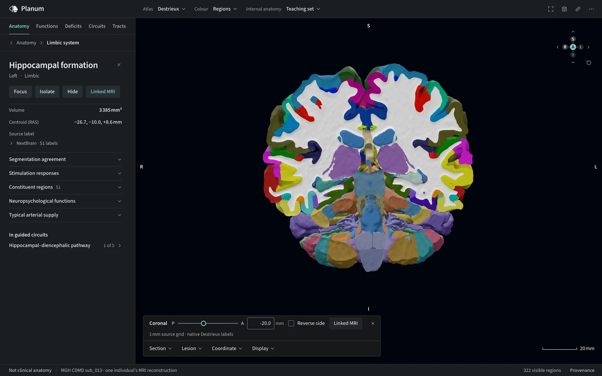
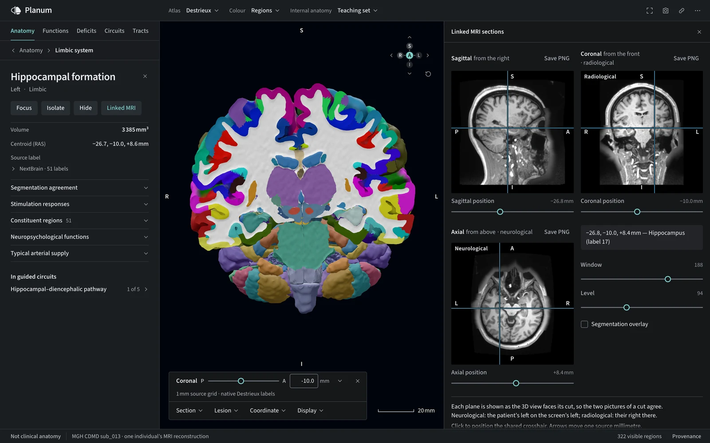
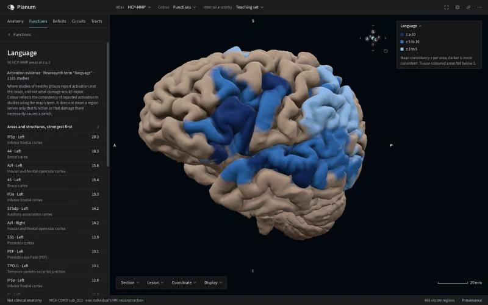
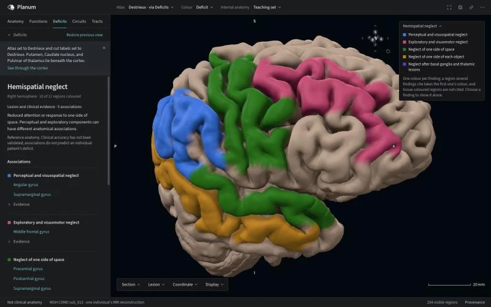
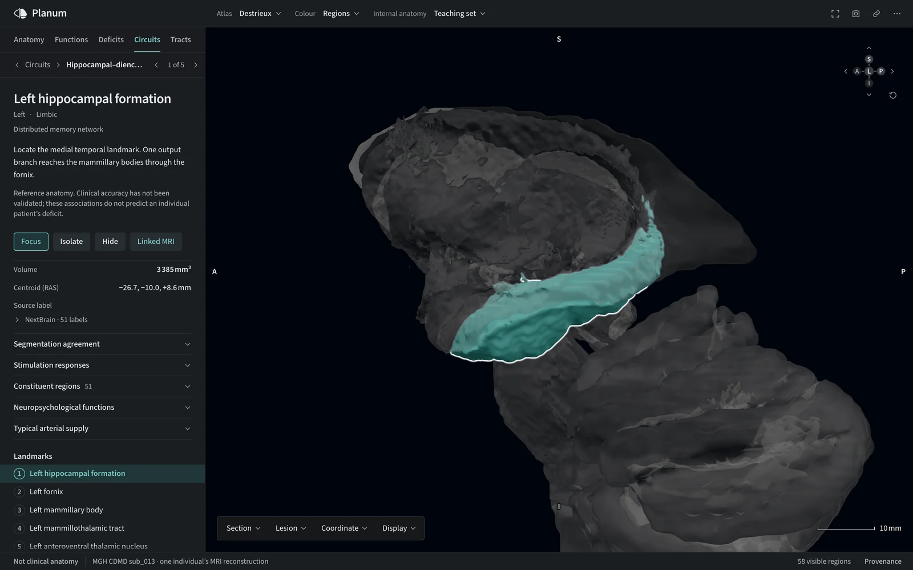
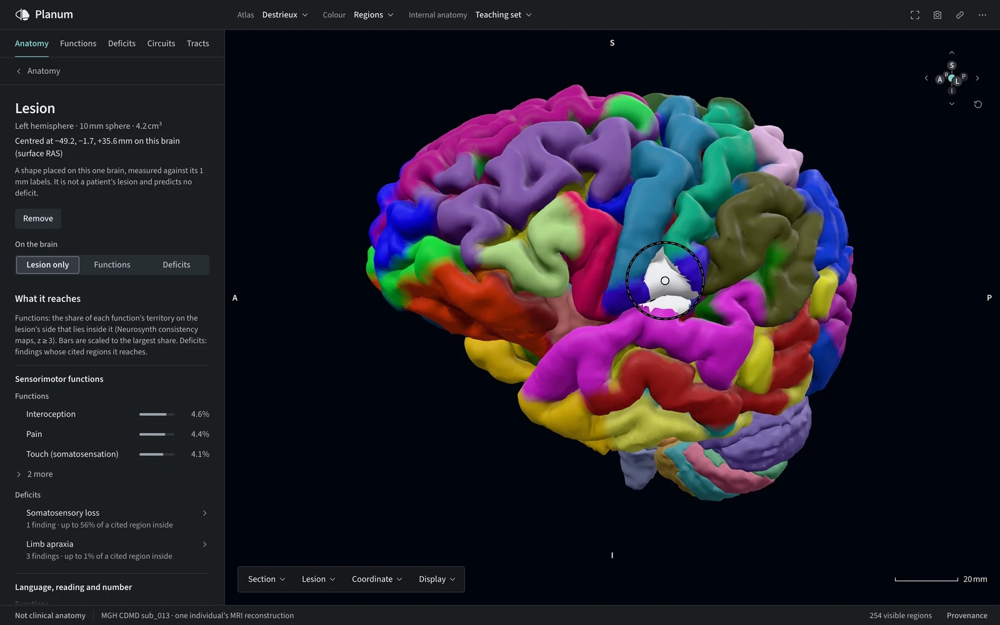
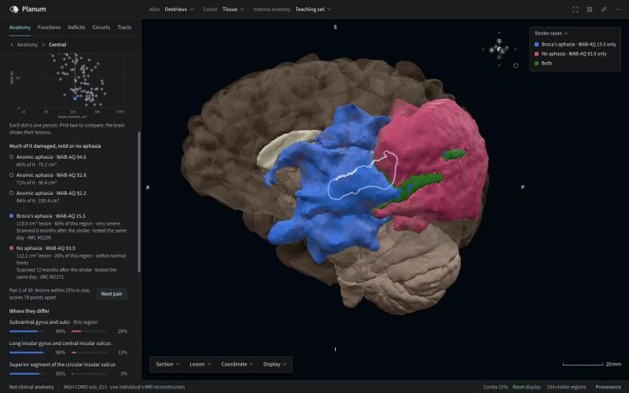
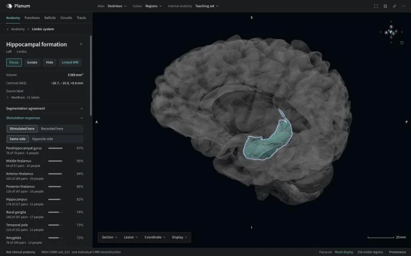
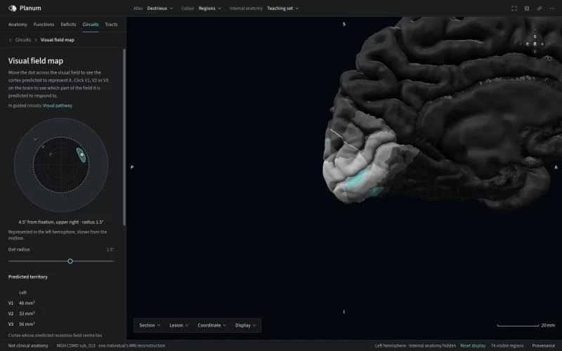

# Planum documentation

```{rst-class} hero-lede
A real human brain, explored in your browser: cut it, measure it, follow its tracts, and see what each region is known for.
```

Planum shows MGH CDMD subject `sub_013`, reconstructed from its own T1 scan with FreeSurfer 8.2, with tracts from the same person's diffusion scan. Every region, cut face and number traces back to that data or to a cited atlas. A Python pipeline builds the assets; a browser viewer displays them, with nothing to install. Planum is for research and education; it is **not clinical anatomy**.

```{figure} ../.github/assets/readme/tracts.webp
:alt: Diffusion tract bundles inside a see-through cortex, with the Tracts panel listing streamline counts and lengths
:class: hero-figure
:target: https://planumatlas.com/#anatomy=cdmd&lang=en&detail=learning&atlas=destrieux&cuts=destrieux&tab=diffusion

Tracts from the subject's own diffusion scan inside a see-through cortex. Select the image to open this view.
```

## What you can do

::::{container} feature-grid

:::{container} feature
[](features/sections-and-cuts.md)

**[Cut it open](features/sections-and-cuts.md)**

Sagittal, coronal, axial or oblique sections, each solid capped and coloured from the label volume.
:::

:::{container} feature
[](features/linked-mri.md)

**[Check it against the scan](features/linked-mri.md)**

The subject's own T1 in three planes around a shared crosshair, with the label under the cursor.
:::

:::{container} feature
[](features/functions.md)

**[See where a function is studied](features/functions.md)**

70 curated functions from Neurosynth meta-analyses, each area ranked by its consistency.
:::

:::{container} feature
[](features/deficits.md)

**[Map what damage is associated with](features/deficits.md)**

121 acquired deficits, each finding with its population, evidence and limits.
:::

:::{container} feature
[](features/circuits.md)

**[Take a guided tour](features/circuits.md)**

Five anatomical pathway tours, 25 landmarks in all, from the visual pathway to corticospinal crossing, that reveal and frame each landmark.
:::

:::{container} feature
[](features/lesion-report.md)

**[Ask what a lesion would reach](features/lesion-report.md)**

A 3–30 mm sphere's overlap with functions, deficits, tissue and tracts. It predicts no deficit.
:::

:::{container} feature
[](features/stroke-cases.md)

**[Weigh a region against real strokes](features/stroke-cases.md)**

For a region some stroke reached, every Aphasia Recovery Cohort case as lesion volume against language score. Compare two people's own lesions on the brain.
:::

:::{container} feature
[](features/stimulation-responses.md)

**[See what stimulating it evokes](features/stimulation-responses.md)**

From stereo-EEG in people with epilepsy: how often a single pulse here evoked a response elsewhere, same or opposite side.
:::

:::{container} feature
[](features/visual-field-map.md)

**[Map the visual field onto the cortex](features/visual-field-map.md)**

Move a point through the visual field and see the V1, V2 and V3 territory predicted to represent it, or click the cortex to read it back.
:::

::::

Search or browse 148 Destrieux parcels, 360 HCP-MMP areas, 278 Julich-Brain areas, 400 Schaefer parcels and 514 NextBrain labels, down to 32 functional cerebellar regions and a 34-region cervical cord. Compare any two cortical atlases by shared surface, colour the cortex by functional network, and share any view as a link: the address bar holds the selection, camera, section, display and a placed lesion. The viewer works in English and French, by keyboard, and on phones.

## Find your way

[Getting started](getting-started/install.md)
: Run the viewer locally, take a tour of the [interface](getting-started/viewer.md), or build this documentation.

[Features](features/index.md)
: One page per feature: what it does, the data it uses, how it was built step by step, the checks it passes and its limits.

[Data and layers](data/index.md)
: The atlases, segmentations and functional layers, their sources and how each reaches the subject.

[Pipeline](pipeline/architecture.md)
: The architecture of the compiler and viewer, how to [build an anatomy](pipeline/building.md), and [validation and limits](pipeline/validation.md).

[Developer reference](developer/api/index.md)
: Browse the Python pipeline API or [embed the viewer components](developer/embedding.md) in a Three.js application.

[References and licensing](reference/references.md)
: The bibliography, data licences and intended use.

The anatomy represents one individual; its folds and asymmetries are not normative. Atlas projections and segmentations are estimates. See [Data and layers](data/index.md) and [References and licensing](reference/references.md) for provenance and data terms.

```{toctree}
:hidden:
:caption: Getting started

getting-started/install
getting-started/viewer
```

```{toctree}
:hidden:
:caption: Features

features/index
```

```{toctree}
:hidden:
:caption: Stage and tools

features/sections-and-cuts
features/linked-mri
features/dissection-and-display
features/lesion-report
features/published-coordinates
features/overlays
features/sharing-and-snapshots
```

```{toctree}
:hidden:
:caption: Anatomy

features/cortical-atlases
features/atlas-comparison
features/internal-anatomy
features/boundary-certainty
features/segmentation-agreement
features/spinal-cord
features/tracts
```

```{toctree}
:hidden:
:caption: Functional and vascular layers

features/functional-networks
features/functional-divisions
features/cerebellar-functions
features/striatal-networks
features/arterial-territories
features/receptor-fingerprints
```

```{toctree}
:hidden:
:caption: Evidence and tours

features/functions
features/deficits
features/circuits
features/visual-field-map
features/stroke-cases
features/stimulation-responses
```

```{toctree}
:hidden:
:caption: Data

data/index
reference/references
```

```{toctree}
:hidden:
:caption: Pipeline

pipeline/architecture
pipeline/building
pipeline/validation
```

```{toctree}
:hidden:
:caption: Developer

developer/api/index
developer/embedding
```

```{toctree}
:hidden:
:caption: Evidence reviews
:glob:

reference/circuit-evidence
reference/full-text-review
reference/deficit-additions-*
reference/hart-2016-review-2026-11-02
reference/teaching-set-audit-2026-11-05
```

```{toctree}
:hidden:
:caption: Project

Open the viewer <https://planumatlas.com/>
Source on GitHub <https://github.com/JoshuaDuq/planumatlas>
```
